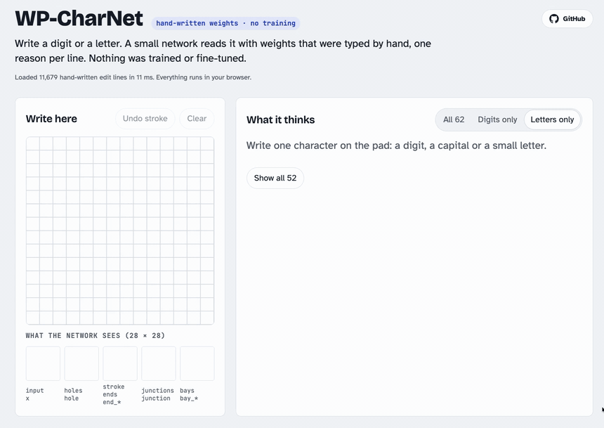

# WP-CharNet

A handwritten-character classifier for 62 classes (0–9, A–Z, a–z) whose weights were **written by hand**, not
trained. Every nonzero parameter comes from one line of a plain-text edit list, and every map, feature and neuron
has a name and a written reason. Inspired by [WPLM](https://huggingface.co/Leejh123e/WPLM), which programmed a
language model the same way.

Structurally it is a convolutional network: shared-weight convolutions build named feature maps (ink, strokes,
stroke ends, junctions, holes, openings, stroke counts along rows, columns and diagonals), followed by a
hand-written readout (zone features, one neuron per handwriting style, and pairwise "referees" for look-alike
characters).

**Try it:** [heldernoid.github.io/WP-CharNet](https://heldernoid.github.io/WP-CharNet/): draw a character and see every
class ranked by probability, the feature maps, and the rule and referees behind the answer. It runs entirely in
the browser.



## Results

Measured on MNIST and EMNIST **training** images that were set aside and never looked at while writing the weights:

| Held-out training images | Own kind only | All 62 classes |
|---|---|---|
| Letters, EMNIST ByClass (52 classes, 120 per class, case-folded) | **72.5%** | — |
| Letters, EMNIST Letters (5,200 images, case-folded) | **73.1%** | 61.3% |
| Digits, MNIST (3,000 images) | **89.3%** | 61.8% |

"Own kind only" ranks only digits or only letters; "all 62" must also beat every class of the other kind (a round
0 against O and o, a stick against 1, I and l). Letters are case-folded because, once a drawing is scaled to the
box, many capitals and small letters have the same shape. No test split has been run on these weights yet.

Strongest letters: P, p, X, x, Z, C, w, m, d (85–93%). Weakest: D (its stem often overshoots into a P or b shape),
g and q (drawn alike in EMNIST), and plain sticks (I, i, l, L look like 1).

| Size | Count |
|---|---|
| hand-written edit lines | 11,679 |
| nonzero parameters | 188,521 |
| all parameters, zeros included | 23.3 M |

Most of the total is the zone layer stored densely (a 28×28 mask per feature and input map); one `ZONE` line writes
a whole mask, so the edit lines are the better count of hand-made decisions.

## How the weights were written

1. **No training.** No gradient descent, no fine-tuning, no weights or statistics copied from a trained model or a
   dataset. Weights come from a generator (`gen/`) in which every value is typed with a stated reason.
2. Claude looked at MNIST and EMNIST **training** images, traces of single images, and per-class feature
   averages, then wrote rules by hand. Nothing is computed from data: no templates, no fitted thresholds, no
   stored examples. Held-out training images were checked only for totals.
3. Every change and the evidence behind it, including the changes that did not work, is in [`LOG.md`](LOG.md).
4. The weights were written by Claude Opus 5.5 (Anthropic), working with the project's author. Its own training very
   likely included handwriting, so its idea of what letters look like is not free of data. That cannot be removed;
   it is stated here instead.

## How it works

| Layers | What they compute | Named outputs |
|---|---|---|
| L1, L3F | ink, and ink thickened by 1 px | `ink`, `ink_core`, `ink_fat` |
| L2 | straight stroke pieces and stroke ends in 8 directions | `run_h/v/d1/d2`, `end_*` |
| L3, L3G, L3H | rays: is there ink anywhere left / right / above / below | `inkL/R/U/D` … |
| LX1–LX5 | strokes crossed by each row / column (1, 2, 3 or more); side profiles | `hx1-3`, `vx1-3`, `marg_*` |
| LD1–LD5 | the same along the / and \\ diagonals | `ax1-3`, `bx1-3` |
| LJ0–LJ3 | a 16-point ring of radius 5 counts the strokes leaving each point | `junction`, `crossing` |
| L3R | strokes relative to the character: stems, bars | `edge_l/r/t/b`, `mid_h/v` |
| L4–L6 | flood fill from the border (24 steps) → holes, openings closed on three sides, gaps | `hole`, `bay_R/L/U/D`, `gap_v` |
| L6C–L6I | relations to holes, wherever the character sits: a stroke between two holes, a stem beside a bowl, ascenders and descenders | `between_holes`, `stem_lh/rh`, `asc_l/r`, `desc_l/r` |
| L7 | how much of each map lies in each zone (top / middle / bottom × left / centre / right) | 543 features, e.g. `bay_R@T` |
| L8 | concepts and whole-letter neurons | `loop_two`, `a_body`, `B_body`, `E_arms`, `S_body`, `tail_below_r` … |
| L9, L10 | one neuron per handwriting style (94 styles); each class takes its best style | `s:4/open`, `s:a/storey` → `best:a` |
| L11–L13M | 307 referees, one per look-alike pair, each a written judgement ("a 3's tail ends pointing up-left; a 2's base ends at the bottom right"), heard only while both classes are near the top; a class drops by its **strongest** single referee loss | `pro:3>2`, `say:3>2`, `loss:2` |
| L14 | class scores: all 62 (`cls:*`), digits only (`dig:*`), letters only (`let:*`) | |

A style rule reads like a description of the character, for example
`"4/open": "bay_U@T*2 end_any@Mr end_any@B run_h@M ... | loop*2"` (expected parts, then contradictions).

The demo turns scores into probabilities with a softmax at a hand-picked temperature (0.5), never fitted. With all
62 classes the percentages run low, so the page also shows how often answers at each level were right on held-out
training images.

## Edit-list format

```
TAP   <layer> <out> <in> <dy> <dx> <value>     conv kernel tap
BIAS  <layer> <out> <value>                    bias (a comment after # gives the reason)
ZONE  <layer> <feat> <in> <rows> <cols> <w>    zone mask (rows/cols a:b or a:b~ramp)
LINK  <layer> <out> <in> <value>               one weight of a linear layer
```

All parameters start at zero; `charnet/engine.py` (Python) and `web/charnet.js` (browser, same scores to 1e-14)
apply the edit list.

## Files

| Path | What |
|---|---|
| `arch.json`, `weights/charnet.edits` | the network: architecture and the hand-written edit list |
| `gen/` | the generator: `generate.py` (layers), `rules.py` (styles, concepts, referees), `handwriting.py` (test characters written as pen strokes) |
| `charnet/engine.py` | the engine |
| `eval/` | the tools used to study training images and score the network |
| `tests/` | per-neuron tests and checks on the rules |
| `web/` | the browser demo |
| `LOG.md` | how the weights were written, step by step |
| `AGENTS.md` | house rules and how to improve the network (for people and AI agents) |

## Run it

```bash
uv venv .venv && uv pip install --python .venv/bin/python numpy pillow scipy pytest
.venv/bin/python gen/generate.py        # write arch.json and weights/charnet.edits
.venv/bin/python -m pytest -q tests     # per-neuron tests
cd web && python3 -m http.server        # demo at http://localhost:8000
```

Datasets are not included. The evaluation tools need [MNIST](http://yann.lecun.com/exdb/mnist/) in `data/mnist/`
and [EMNIST](https://www.nist.gov/itl/products-and-services/emnist-dataset) (the
[gzip release](https://biometrics.nist.gov/cs_links/EMNIST/gzip.zip)) in `data/emnist/gzip/`; download commands are
in [`eval/README.md`](eval/README.md#data).

## License

MIT (see [`LICENSE`](LICENSE)): the code, the generator, the rules and the weights.

## Known limits

- Some characters share a shape once rescaled to the box: 0/O/o, 1/I/l, c/C, s/S, v/V, w/W, x/X, z/Z, p/P, k/K,
  u/U, y/Y. A plain stick stays a guess between 1, I and l.
- With all 62 classes, about a third of digit images still go to a look-alike letter.
